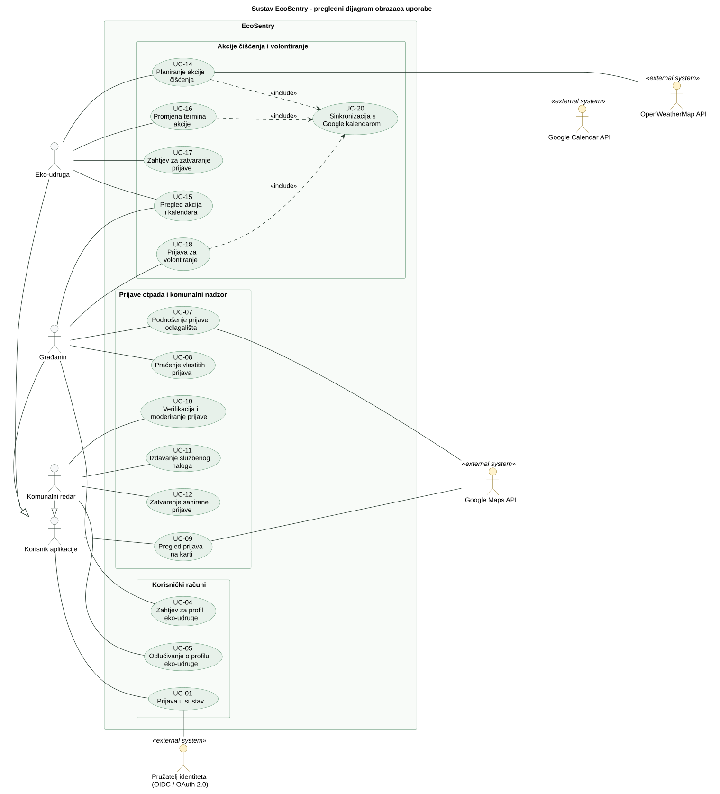

# 3. Obrasci uporabe — EcoSentry

## 3.1 Dijagram obrazaca uporabe

Dijagram prikazuje granicu sustava EcoSentry i korisničke ciljeve. Primarni akteri su Građanin, Eko-udruga i Komunalni redar; zajedničke radnje nasljeđuju od apstraktne uloge Korisnik aplikacije. Vanjski pružatelj identiteta, Google Maps, Google Calendar i OpenWeatherMap predstavljaju sekundarne aktere ondje gdje su potrebni za ostvarivanje cilja.

**Slika 3.1. Dijagram obrazaca uporabe sustava EcoSentry.**  
**PlantUML izvor:** [3-1-ecosentry-system-UC.puml](./puml/3-1-ecosentry-system-UC.puml)

- Prijava u sustav zaseban je obrazac uporabe; za ostale zaštićene radnje prijava je **preduvjet**, a ne `<<include>>`.
- Fotografija je obvezna za podnošenje prijave, stoga nije modelirana kao neobvezno proširenje.
- Potvrđivanje prijave, planiranje akcije, slanje dokaza i zatvaranje prijave različiti su ciljevi različitih uloga.    
- Dohvat vremenske prognoze i geokodiranje opisani su unutar glavnih tijekova odgovarajućih obrazaca uporabe, a ne kao zasebni UC-ovi.
- Nije pretpostavljeno da komunalna tvrtka ima korisnički račun u aplikaciji (AS-07).
- UC-20 uključuje se u UC-14, UC-16 i UC-18 pomoću odnosa `<<include>>`. Sustav u svakom od tih postupaka pokušava sinkronizirati događaj s Google kalendarom, ali neuspjeh vanjskog servisa ne poništava osnovnu radnju, u skladu s NF-1.4.

Dijagram je podijeljen u tri funkcionalne cjeline: **Korisnički računi**, **Prijave otpada i komunalni nadzor** te **Akcije čišćenja i volontiranje**.

Radi preglednosti, UC-02 Odjava iz sustava, UC-03 Brisanje vlastitog profila, UC-06 Blokiranje korisnika, UC-13 Pregled analitike i izvještaja te UC-19 Otkazivanje sudjelovanja u akciji nisu prikazani na preglednom dijagramu. Navedene funkcionalnosti ostaju dio opsega sustava i zasebno su opisane u poglavlju 3.2.

## 3.2 Specifikacije obrazaca uporabe

Za svaki UC prikazan je cilj, primarni akter, povezani funkcijski zahtjevi, preduvjeti, glavni uspješni tok, iznimke i postuvjeti. Alternative su vezane uz korak u glavnom toku.

### UC-01: Prijava u sustav

| Element specifikacije | Opis |
| :--- | :--- |
| **Primarni akter** | Korisnik aplikacije |
| **Povezani zahtjevi** | F-01.1 |
| **Preduvjeti** | Sustav je dostupan. |
| **Glavni uspješni tok** | 1. Korisnik odabire prijavu. 2. Sustav ga usmjerava vanjskom pružatelju identiteta. 3. Korisnik potvrđuje identitet. 4. Sustav potvrđuje identitet i otvara korisničku sesiju. 5. Pri prvom pristupu dodjeljuje ulogu Građanin. |
| **Alternativni tokovi / Iznimke** | 3a — Korisnik odustaje ili prijava ne uspije: sustav ne uspostavlja sesiju i prikazuje poruku. |
| **Posljedice (ishod)** | Korisnik je prijavljen i može pristupiti radnjama dopuštenima svojoj ulozi. |

### UC-02: Odjava iz sustava

| Element specifikacije | Opis |
| :--- | :--- |
| **Primarni akter** | Korisnik aplikacije |
| **Povezani zahtjevi** | F-01.2 |
| **Preduvjeti** | Korisnik je prijavljen. |
| **Glavni uspješni tok** | 1. Korisnik zatraži odjavu. 2. Sustav prekida aktivnu sesiju. 3. Sustav potvrđuje odjavu i prikazuje javni dio aplikacije. |
| **Alternativni tokovi / Iznimke** | 2a — Odjava nije uspjela: sustav ne prikazuje potvrdu odjave i prikazuje pogrešku. |
| **Posljedice (ishod)** | Zaštićene radnje nisu dostupne bez ponovne prijave. |

### UC-03: Brisanje vlastitog profila

| Element specifikacije | Opis |
| :--- | :--- |
| **Primarni akter** | Korisnik aplikacije |
| **Povezani zahtjevi** | F-01.3 |
| **Preduvjeti** | Korisnik je prijavljen. |
| **Glavni uspješni tok** | 1. Korisnik otvara postavke profila i odabire brisanje. 2. Sustav traži potvrdu. 3. Korisnik potvrđuje brisanje. 4. Sustav briše podatke profila, uklanja podatke o podnositelju iz postojećih prijava i prekida sesiju. |
| **Alternativni tokovi / Iznimke** | 3a — Korisnik odustaje: profil ostaje nepromijenjen. 4a — Brisanje nije uspjelo: sustav prikazuje pogrešku bez potvrde uspjeha. |
| **Posljedice (ishod)** | Profil je uklonjen; ranije prijave ostaju bez identiteta podnositelja. |

### UC-04: Podnošenje zahtjeva za profil eko-udruge

| Element specifikacije | Opis |
| :--- | :--- |
| **Primarni akter** | Građanin |
| **Povezani zahtjevi** | F-02.1 |
| **Preduvjeti** | Korisnik je prijavljen. |
| **Glavni uspješni tok** | 1. Korisnik odabire zahtjev za profil udruge. 2. Sustav prikazuje polja naziv udruge, registracijski broj i regija djelovanja. 3. Korisnik unosi podatke i šalje zahtjev. 4. Sustav provjerava obvezne podatke, pohranjuje zahtjev i potvrđuje zaprimanje. |
| **Alternativni tokovi / Iznimke** | 4a — Podaci nisu valjani: zahtjev se ne pohranjuje, sustav traži ispravak. 4b — Pohrana ne uspije: nema potvrde predaje. |
| **Posljedice (ishod)** | Zahtjev čeka odluku redara; korisnik još nema ovlasti organizatora. |

### UC-05: Odlučivanje o profilu eko-udruge

| Element specifikacije | Opis |
| :--- | :--- |
| **Primarni akter** | Komunalni redar |
| **Povezani zahtjevi** | F-02.2 |
| **Preduvjeti** | Redar je prijavljen i postoji zahtjev za profil udruge. |
| **Glavni uspješni tok** | 1. Redar otvara zahtjev i pregledava podatke. 2. Redar odobrava ili odbija zahtjev. 3. Sustav provjerava ovlast i sprema odluku. 4. Sustav prikazuje konačan ishod zahtjeva. |
| **Alternativni tokovi / Iznimke** | 2a — Zahtjev je odbijen: korisnik ne dobiva ulogu udruge. 3a — Redar nema ovlast ili spremanje ne uspije: odluka nije potvrđena. |
| **Posljedice (ishod)** | Odobrenjem korisnik dobiva ovlasti eko-udruge; odbijanjem ne. |

### UC-06: Blokiranje korisnika

| Element specifikacije | Opis |
| :--- | :--- |
| **Primarni akter** | Komunalni redar |
| **Povezani zahtjevi** | F-02.3 |
| **Preduvjeti** | Redar je prijavljen; postoji korisnički račun. |
| **Glavni uspješni tok** | 1. Redar pronalazi korisnički profil. 2. Redar odabire blokiranje korisnika. 3. Sustav provjerava ovlasti i evidentira blokadu. 4. Sustav potvrđuje promjenu statusa korisnika. |
| **Alternativni tokovi / Iznimke** | 3a — Nedostatne ovlasti ili pogreška spremanja: status korisnika ostaje nepromijenjen. |
| **Posljedice (ishod)** | Blokirani korisnik ne može podnositi prijave ni prijavljivati se na akcije. |

### UC-07: Podnošenje prijave odlagališta

| Element specifikacije | Opis |
| :--- | :--- |
| **Primarni akter** | Građanin |
| **Povezani zahtjevi** | F-03.1, F-04.2 |
| **Preduvjeti** | Građanin je prijavljen. |
| **Glavni uspješni tok** | 1. Građanin otvara prijavu otpada. 2. Sustav pribavlja GPS lokaciju i prikazuje položaj na karti. 3. Građanin prilaže fotografiju iz kamere ili galerije i bira kategoriju otpada. 4. Građanin podnosi prijavu. 5. Sustav provjerava podatke i trajno pohranjuje prijavu. 6. Sustav potvrđuje podnošenje i prikazuje identifikator prijave. |
| **Alternativni tokovi / Iznimke** | 2a — Pristup GPS-u odbijen: prema pretpostavci AS-01 građanin može ručno označiti lokaciju. 5a — Nedostaje fotografija ili kategorija, ili je datoteka nevaljana: prijava se ne sprema. 5b — Pohrana ne uspije: nema potvrde uspješnog podnošenja. |
| **Posljedice (ishod)** | Prijava je pohranjena sa statusom Prijavljeno i dostupna za daljnju obradu. |

### UC-08: Praćenje vlastitih prijava

| Element specifikacije | Opis |
| :--- | :--- |
| **Primarni akter** | Građanin |
| **Povezani zahtjevi** | F-03.2, F-03.3 |
| **Preduvjeti** | Građanin je prijavljen. |
| **Glavni uspješni tok** | 1. Građanin otvara povijest prijava. 2. Sustav prikazuje njegove prijave s datumima, kategorijama i trenutačnim statusima. 3. Građanin odabire pojedinu prijavu. 4. Sustav prikazuje detalje i dostupne obavijesti o promjenama statusa. |
| **Alternativni tokovi / Iznimke** | 2a — Građanin nema prijava: prikazuje se prazan popis. 4a — Nema promjena statusa: obavijest nije prikazana. |
| **Posljedice (ishod)** | Građanin može pregledati stanje svojih prijava; pri promjenama statusa sustav generira push ili unutaraplikacijsku obavijest s brojem prijave i novim statusom. |

### UC-09: Pregled prijava na karti

| Element specifikacije | Opis |
| :--- | :--- |
| **Primarni akter** | Korisnik aplikacije |
| **Povezani zahtjevi** | F-04.1, F-04.2, F-06.1 |
| **Preduvjeti** | Karta je dostupna. |
| **Glavni uspješni tok** | 1. Korisnik otvara kartu prijava. 2. Sustav prikazuje oznake prema statusu i odgovarajuće lokacije preko Google Maps usluge. 3. Korisnik odabire oznaku. 4. Sustav prikazuje detalje prijave i fotografiju. 5.  Ako je korisnik eko-udruga, sustav prikazuje prijave u njezinoj regiji i dostupnu procjenu volumena otpada. |
| **Alternativni tokovi / Iznimke** | 2a — Kartografska usluga nije dostupna: sustav prikazuje poruku o pogrešci. 3a — Odabrana prijava je uklonjena: detalji nisu dostupni. |
| **Posljedice (ishod)** | Korisnik dobiva pregled geografskih lokacija i detalja prijava u skladu sa svojim ovlastima. |

### UC-10: Verifikacija i moderiranje prijave

| Element specifikacije | Opis |
| :--- | :--- |
| **Primarni akter** | Komunalni redar |
| **Povezani zahtjevi** | F-05.1, F-05.2 |
| **Preduvjeti** | Redar je prijavljen; postoji predana prijava. |
| **Glavni uspješni tok** | 1. Redar otvara prijavu za pregled. 2. Sustav prikazuje lokaciju, kategoriju i fotografiju. 3. Redar po potrebi ispravlja kategoriju i odabire potvrđivanje ili odbacivanje. 4. Sustav provjerava ovlasti i sprema odluku. 5. Sustav prikazuje izmijenjeni status i podatke. |
| **Alternativni tokovi / Iznimke** | 3a — Prijava je odbačena: uklanja se s karte. 4a — Ovlasti ne vrijede ili pohrana ne uspije: promjena nije potvrđena. |
| **Posljedice (ishod)** | Prijava je verificirana ili odbačena; izmjene kategorije evidentirane su. |

### UC-11: Izdavanje službenog naloga

| Element specifikacije | Opis |
| :--- | :--- |
| **Primarni akter** | Komunalni redar |
| **Povezani zahtjevi** | F-05.3 |
| **Preduvjeti** | Redar je prijavljen; otpad zahtijeva službenu sanaciju. |
| **Glavni uspješni tok** | 1. Redar odabire prijavu s opasnim ili prevelikim otpadom. 2. Redar zatraži izdavanje naloga. 3. Sustav generira nalog i prosljeđuje ga ugovorenoj komunalnoj tvrtki. 4. Sustav evidentira prosljeđivanje te mijenja status prijave u Službena sanacija. 5. Sustav potvrđuje nalog redaru. |
| **Alternativni tokovi / Iznimke** | 3a — Prosljeđivanje nije uspjelo: sustav ne tvrdi da je nalog dostavljen; redara obavještava o problemu. |
| **Posljedice (ishod)** | Nalog je proslijeđen, a prijava označena za službenu sanaciju. |

### UC-12: Zatvaranje sanirane prijave

| Element specifikacije | Opis |
| :--- | :--- |
| **Primarni akter** | Komunalni redar |
| **Povezani zahtjevi** | F-05.4, F-03.3 |
| **Preduvjeti** | Redar je prijavljen; postoji prijava za koju je dostupan dokaz o sanaciji ili redar može priložiti dokaz. |
| **Glavni uspješni tok** | 1. Redar pregledava zahtjev udruge za zatvaranje ili učitava vlastitu fotografiju saniranog stanja. 2. Redar potvrđuje zatvaranje. 3. Sustav provjerava ovlasti i trajno sprema promjenu statusa na Očišćeno. 4. Sustav obavještava podnositelja o novom statusu i prikazuje potvrdu redaru. |
| **Alternativni tokovi / Iznimke** | 2a — Redar odbija zahtjev udruge: prijava ne prelazi u Očišćeno. 3a — Nedostaje dokaz, ovlasti ili spremanje ne uspije: zatvaranje se ne potvrđuje. |
| **Posljedice (ishod)** | Prijava ima status Očišćeno i podnositelj prima obavijest. |

### UC-13: Pregled analitike i izvještaja

| Element specifikacije | Opis |
| :--- | :--- |
| **Primarni akter** | Komunalni redar |
| **Povezani zahtjevi** | F-05.5 |
| **Preduvjeti** | Redar je prijavljen. |
| **Glavni uspješni tok** | 1. Redar odabire analitički pregled. 2. Sustav izračunava broj prijava po mjesecima, najkritičnije kvartove i postotak riješenih prijava. 3. Sustav prikazuje grafikone i pokazatelje. |
| **Alternativni tokovi / Iznimke** | 2a — Nema podataka za razdoblje: sustav prikazuje prazne pokazatelje bez izmišljanja vrijednosti. |
| **Posljedice (ishod)** | Redar ima pregled statistike prijava i sanacija. |

### UC-14: Planiranje akcije čišćenja

| Element specifikacije | Opis |
| :--- | :--- |
| **Primarni akter** | Eko-udruga |
| **Povezani zahtjevi** | F-06.2, F-08, F-09.1, F-09.2 |
| **Preduvjeti** | Profil udruge je odobren; postoje aktivne prijave. |
| **Glavni uspješni tok** | 1. Udruga odabire jednu ili više prijava s karte. 2. Sustav prikazuje odabrane lokacije i prognozu za termin akcije. 3. Udruga unosi naziv, opis, broj volontera, termin i mjesto okupljanja. 4. Sustav provjerava podatke i upozorava ako je najavljeno nevrijeme. 5. Udruga potvrđuje planiranje. 6. Sustav sprema akciju, ažurira status uključenih prijava i pokušava stvoriti događaj u Google kalendaru. 7. Sustav potvrđuje kreiranu akciju i prikazuje rezultat sinkronizacije. |
| **Alternativni tokovi / Iznimke** | 4a — Nevrijeme: sustav označava upozorenje i omogućuje drugi termin. 6a — Google Calendar nije dostupan ili nema pristanka: prema NF-1.4 akcija ipak ostaje spremljena, uz poruku o nesinkroniziranom kalendaru. 6b — Pohrana akcije ne uspije: nema potvrde kreiranja. |
| **Posljedice (ishod)** | Akcija postoji u sustavu; statusi pridruženih prijava ažurirani su, a ishod sinkronizacije s kalendarom je vidljiv. |

### UC-15: Pregled akcija i kalendara

| Element specifikacije | Opis |
| :--- | :--- |
| **Primarni akter** | Eko-udruga ili Građanin |
| **Povezani zahtjevi** | F-06.3, F-09.1, F-04.3 |
| **Preduvjeti** | Postoji ili može postojati planirana akcija. |
| **Glavni uspješni tok** | 1. Akter otvara popis akcija ili kalendar. 2. Sustav prikazuje planirane akcije i njihove termine. 3. Akter odabire akciju. 4. Sustav prikazuje detalje, popunjenost, mjesto okupljanja, rutu do lokacije i dostupnu vremensku prognozu. |
| **Alternativni tokovi / Iznimke** | 2a — Nema akcija: prikazuje se prazan popis. 4a — Prognoza, ruta ili vanjska usluga nije dostupna: prikazuje se osnovni sadržaj akcije i razumljiva poruka. |
| **Posljedice (ishod)** | Akter može proučiti detalje akcije i planirati dolazak. |

### UC-16: Promjena termina akcije

| Element specifikacije | Opis |
| :--- | :--- |
| **Primarni akter** | Eko-udruga |
| **Povezani zahtjevi** | F-06.4, F-08, F-09.2 |
| **Preduvjeti** | Udruga ima ovlasti za akciju koja je već planirana. |
| **Glavni uspješni tok** | 1. Udruga odabire planiranu akciju. 2. Sustav prikazuje trenutačni termin i vremensku prognozu. 3. Udruga određuje novi termin i potvrđuje promjenu. 4. Sustav pohranjuje promjenu, pokušava ažurirati Google kalendar i obavještava prijavljene volontere. 5. Sustav prikazuje novi termin i ishod ažuriranja. |
| **Alternativni tokovi / Iznimke** | 3a — Novi termin nije valjan: sustav traži drugi termin. 4a — Kalendar je nedostupan: novi termin ostaje spremljen, ali se prikazuje upozorenje o neuspjeloj sinkronizaciji. |
| **Posljedice (ishod)** | Termin akcije promijenjen je u EcoSentryju, a volonteri su obaviješteni. |

### UC-17: Podnošenje zahtjeva za zatvaranje prijave

| Element specifikacije | Opis |
| :--- | :--- |
| **Primarni akter** | Eko-udruga |
| **Povezani zahtjevi** | F-06.5 |
| **Preduvjeti** | Udruga je prijavljena; akcija je provedena. |
| **Glavni uspješni tok** | 1. Udruga odabire provedenu akciju i pripadajuće prijave. 2. Sustav nudi predaju dokaza o sanaciji. 3. Udruga učitava fotografiju očišćenog prostora. 4. Udruga podnosi zahtjev za zatvaranje. 5. Sustav provjerava fotografiju, sprema zahtjev i potvrđuje predaju redaru. |
| **Alternativni tokovi / Iznimke** | 5a — Fotografija nije priložena ili nije valjana: zahtjev se ne sprema. 5b — Spremanje ne uspije: nema potvrde predaje. |
| **Posljedice (ishod)** | Zahtjev za zatvaranje čeka odluku komunalnog redara; prijava još nije automatski zatvorena. |

### UC-18: Prijava za volontiranje

| Element specifikacije | Opis |
| :--- | :--- |
| **Primarni akter** | Građanin |
| **Povezani zahtjevi** | F-07.1, F-08 |
| **Preduvjeti** | Građanin je prijavljen; postoji akcija s raspoloživim mjestima. |
| **Glavni uspješni tok** | 1. Građanin pregledava akcije i odabire željenu. 2. Sustav prikazuje detalje akcije, mjesta i lokaciju okupljanja. 3. Građanin potvrđuje sudjelovanje. 4. Sustav ponovno provjerava raspoloživost te sprema prijavu. 5. Sustav pokušava izraditi događaj u Google kalendaru uz potreban pristanak. 6. Sustav prikazuje potvrdu i status sinkronizacije. |
| **Alternativni tokovi / Iznimke** | 4a — Akcija je popunjena: prijava se ne sprema. 4b — Korisnik je blokiran: prijava se odbija. 5a — Kalendar nije dostupan ili nema pristanka: sudjelovanje ostaje zabilježeno i prikazuje se obavijest o sinkronizaciji. |
| **Posljedice (ishod)** | Građanin je prijavljen kao volonter, a broj dostupnih mjesta ažuriran. |

### UC-19: Otkazivanje sudjelovanja u akciji

| Element specifikacije | Opis |
| :--- | :--- |
| **Primarni akter** | Građanin |
| **Povezani zahtjevi** | F-07.2 |
| **Preduvjeti** | Građanin je prijavljen za akciju. |
| **Glavni uspješni tok** | 1. Građanin otvara svoje prijave na akcije. 2. Građanin odabire otkazivanje sudjelovanja. 3. Sustav provjerava prijavu i evidentira otkazivanje. 4. Sustav potvrđuje promjenu i oslobađa volontersko mjesto. |
| **Alternativni tokovi / Iznimke** | 3a — Prijava više ne postoji ili pohrana ne uspije: sustav ne potvrđuje otkazivanje. |
| **Posljedice (ishod)** | Građanin više nije među prijavljenima; mjesto je ponovno raspoloživo. |

### UC-20: Sinkronizacija s Google kalendarom

| Element specifikacije | Opis |
| :--- | :--- |
| **Primarni akter** | Eko-udruga ili Građanin, posredno kroz UC-14, UC-16 ili UC-18 |
| **Povezani zahtjevi** | F-08 |
| **Preduvjeti** | Pokrenuto je planiranje akcije, promjena termina postojeće akcije ili prijava za volontiranje. |
| **Glavni uspješni tok** | 1. Sustav pokreće sinkronizaciju kalendarskog događaja. 2. Provjerava potrebnu autorizaciju i pristanak. 3. Sustav stvara novi događaj ili ažurira postojeći događaj putem Google Calendar API-ja, ovisno o radnji koja je pokrenula sinkronizaciju. 4. Bilježi i prikazuje rezultat sinkronizacije. |
| **Alternativni tokovi / Iznimke** | 2a — Korisnik nije dao pristanak: događaj se ne šalje. 3a — Google Calendar nije dostupan: sustav bilježi neuspjelu sinkronizaciju. |
| **Posljedice (ishod)** | Sinkronizacija je provedena ili je zabilježen njezin neuspjeh. Osnovna radnja ostaje uspješna. |

## 3.3 Provjera dosljednosti obrazaca uporabe

| Provjera | Rezultat / akcija za tim |
| :--- | :--- |
| Povezanost s analizom zahtjeva | Funkcijski zahtjevi F-01.1–F-09.2 povezani su s opisanim UC-ovima. |
| Akteri | Primarne uloge odgovaraju poglavlju 2.3 analize zahtjeva. Zajednička uloga **Korisnik aplikacije** modelna je generalizacija, nije novi tip računa. |
| Fotografije i GPS | Fotografija i kategorija su obvezne za F-03.1; ručno zadavanje lokacije proizlazi iz pretpostavke AS-01, ne iz izričitog izvornog zahtjeva. |
| Moderiranje i vidljivost | AS-02 pretpostavlja da prijave mogu biti vidljive prije verifikacije; tim treba potvrditi vidljivost po ulogama. |
| Potvrda sanacije | AS-04 predviđa da redar potvrđuje zahtjev udruge prije statusa **Očišćeno**. Potrebno potvrditi s nastavnikom. |
| Kalendar i prognoza | F-08, F-09.1, F-09.2 pojavljuju se u tokovima relevantnih ciljeva; NF-1.4 nalaže da nedostupnost tih servisa ne blokira osnovnu funkcionalnost. |
| Pristanak za kalendar | C-04 traži pristanak korisnika, a vanjski pružatelj identiteta ne implicira automatsku dozvolu pisanja u Google Calendar. |
| Provjera implementacije | Svi tijekovi opisani su kao predviđeno ponašanje. Tim treba usporediti s implementacijom i ispitnim slučajevima; nijedan nije unaprijed označen kao ispitan. |

**Napomena o sljedivosti:** Cjelovita matrica sljedivosti ostaje samo u poglavlju **2.6** datoteke `docs/2-Analiza-zahtjeva.md`, prema primjeru. Ovdje je ne dupliciramo.

**Otvorene odluke prije konačne predaje:** potvrditi ručni odabir lokacije (AS-01), vidljivost neverificiranih prijava (AS-02), pravilo potvrde sanacije (AS-04), kanal dostave naloga (AS-07) i dostupnost Google Calendar autorizacije (C-04). Zadržati odobrene funkcijske zahtjeve bez nadopisivanja neutemeljenih novih funkcionalnosti.
