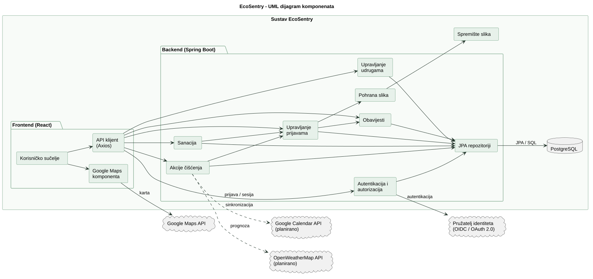
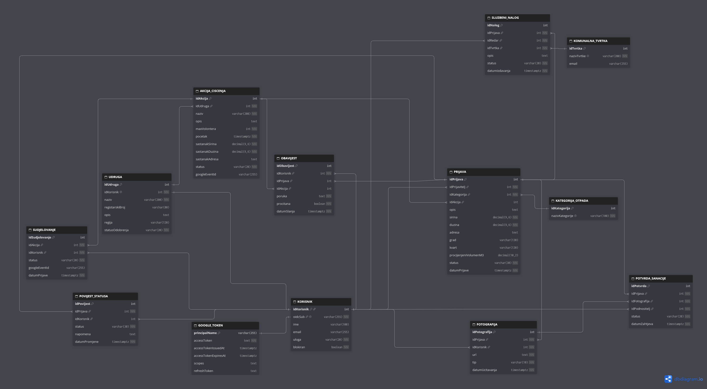
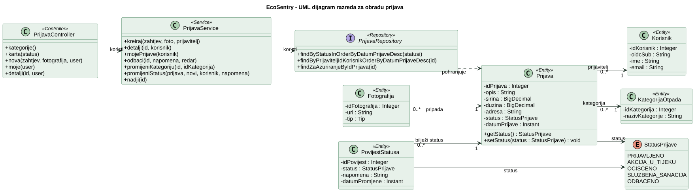
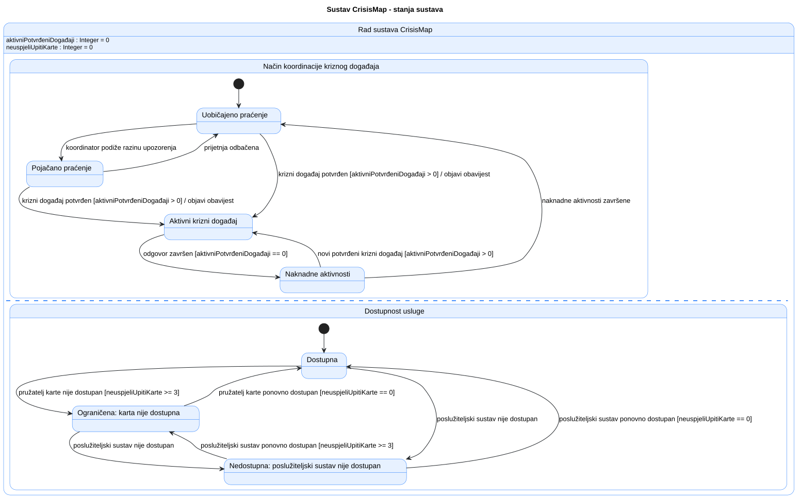

# 4. Arhitektura i oblikovanje

**Cilj:** Definirati arhitekturni stil, dekompoziciju programa na podsustave i module, organizaciju podataka te dinamičko ponašanje tijekom izvođenja. Arhitektura predstavlja temelj za implementaciju i ažurira se pri svakoj važnijoj promjeni projektnih odluka.

| Arhitekturni pogled | Ključno inženjersko pitanje | Primijenjeni model ili dijagram |
| :--- | :--- | :--- |
| **Strategija rješenja** | Koji stil i temeljne odluke određuju program? | Tablica odluka (odjeljak 4.1) |
| **Struktura podsustava** | Koji su glavni dijelovi i kako komuniciraju? | Dijagram komponenata |
| **Model podataka** | Kako su strukturirani trajni podaci programa? | Relacijski ER dijagram |
| **Struktura koda** | Kako su dodijeljene odgovornosti i ključne klase? | Reprezentativni dijagram razreda |
| **Dinamičko ponašanje** | Kako moduli surađuju pri obradi ključnih transakcija? | sekvencijski dijagram |
| **Stanja sustava** | Kako ključni domenski objekt mijenja svoja stanja? | Dijagram stanja |
| **Fizički razmještaj** | Na kojim se izvršnim čvorovima program izvodi? | Dijagram razmještaja (poglavlje 6) |

---

## 4.1 Ključne arhitekturne odluke

**Cilj:** Objasniti nekoliko arhitekturnih odluka koje najviše utječu na rješenje i navesti njihove projektno specifične razloge.

| Odluka | Razmatrana alternativa | Projektno specifično obrazloženje i kompromis |
| --- | --- | --- |
| Relacijska baza podataka (PostgreSQL) | Dokumentna baza podataka (npr. MongoDB) | Podaci sustava EcoSentry međusobno su povezani: prijave pripadaju korisnicima i kategorijama otpada, imaju fotografije i povijest statusa te se povezuju s akcijama čišćenja i sanacijom. PostgreSQL omogućuje definiranje stranih ključeva, ograničenja integriteta i transakcija. Nedostatak je potreba za održavanjem sheme i migracijama pri promjenama modela podataka. |
| Odvojeni klijentski i poslužiteljski dio aplikacije | Jedinstvena aplikacija u kojoj poslužitelj generira korisničko sučelje | Odvajanje frontenda i backenda omogućuje neovisno razvijanje korisničkog sučelja i poslužiteljske logike. Klijent prikuplja i prikazuje podatke, a poslužitelj obrađuje zahtjeve, provjerava korisničke ovlasti i pristupa bazi podataka. Kompromis je potreba za jasno definiranim API-jem i dodatnim radom pri integraciji dvaju dijelova aplikacije. |

## 4.2 Gradivni blokovi i UML dijagram komponenata

**Cilj:** Prikazati logičku podjelu programa na komponente, njihova sučelja i vanjske integracije. Dijagram komponenata prikazuje logičku organizaciju, dok dijagram razmještaja prikazuje fizičko izvođenje. Ovaj prikaz ažurirajte kako sustav poprima konačan oblik.

**Slika 4.1. UML dijagram komponenata sustava EcoSentry**

**PlantUML izvor:** [4-1-ecosentry-system-CMP.puml](./puml/4-1-ecosentry-system-CMP.puml)

| Komponenta | Odgovornost | Razlog za ovu granicu |
| --- | --- | --- |
| Korisničko sučelje | Prikaz stranica i interakcija korisnika | Odvajanje prikaza od poslovne logike |
| API klijent |	Komunikacija s backendom |	Centralizirani HTTP zahtjevi |
| Autentikacija i autorizacija | Prijava, korisničke uloge i pristup |	Sigurnosna pravila na jednom mjestu |
| Upravljanje prijavama |	Kreiranje, pregled i moderiranje odlagališta |	Izdvojena logika životnog ciklusa prijava |
| Upravljanje udrugama 	| Zahtjevi i odobravanje profila udruga |	Odvajanje upravljanja udrugama |
| Akcije čišćenja |	Planiranje akcija i povezivanje s prijavama |	Posebna pravila organiziranja akcija |
| Sanacija |	Potvrde i obrada sanacije | Odvajanje završetka sanacije od podnošenja prijave |
| Obavijesti |	Evidencija i dohvat obavijesti |	Centralizirana obrada obavijesti |
| Pohrana slika |	Obrada i spremanje fotografija |	Odvajanje datoteka od relacijskih podataka |
| JPA repozitoriji |	Pristup trajnim podacima |	Odvajanje poslovne logike od pohrane |

Sustav EcoSentry podijeljen je na klijentski dio razvijen u Reactu i poslužiteljski dio razvijen u Spring Bootu. Klijentski dio omogućuje interakciju s korisnicima, a poslužiteljski obrađuje zahtjeve, provjerava ovlasti, provodi poslovna pravila i pristupa PostgreSQL bazi podataka putem JPA repozitorija.

Poslužiteljski dio organiziran je u funkcionalne module za prijave odlagališta, korisnike, eko-udruge, akcije čišćenja, sanaciju, obavijesti i obradu fotografija. Ti moduli dio su jedne poslužiteljske aplikacije, a ne zasebno postavljene mikrousluge.

Vanjske usluge prikazane su izvan granice sustava. Pružatelj identiteta koristi se za autentikaciju, a Google Maps API za prikaz karte. Integracije s Google Calendar API-jem i OpenWeatherMap API-jem predviđene su zahtjevima sustava te su na dijagramu označene kao planirane.

## 4.3 Model podataka i oblikovanje razreda

**Cilj:** Objasniti važne informacije koje aplikacija pohranjuje i jedno reprezentativno područje oblikovanja na razini razreda. Model podataka i UML dijagram razreda odgovaraju na različita pitanja; jedno ne zamjenjuje drugo.

### 4.3.1 ER dijagram i model podataka

**Cilj:** Prikazati važne pohranjene entitete, njihove identifikatore i veze te dovoljno atributa za razumijevanje podataka aplikacije. ER dijagram odvojen je od reprezentativnog UML dijagrama razreda u nastavku.

**Slika 4.2. ER dijagram podataka sustava EcoSentry**

**Izvor dijagrama:** [ecosentry_dijagram.dbml](../db/ecosentry_dijagram.dbml)  
**Implementacija:** [ecosentry_baza.sql](../db/ecosentry_baza.sql)

Središnji entitet modela podataka sustava EcoSentry jest `PRIJAVA`, koja predstavlja prijavljeno divlje odlagalište otpada. Svaka prijava povezana je s korisnikom koji ju je podnio (`KORISNIK`) i kategorijom otpada (`KATEGORIJA_OTPADA`). Prijava sadrži podatke o lokaciji, vremenu podnošenja i trenutačnom statusu. Fotografije prijave pohranjuju se u tablici `FOTOGRAFIJA`, dok se promjene statusa evidentiraju u tablici `POVIJEST_STATUSA`.

Korisnik može podnijeti zahtjev za profil eko-udruge, čiji se podaci i status odobrenja evidentiraju u tablici `UDRUGA`. Odobrena eko-udruga može organizirati akcije čišćenja (`AKCIJA_CISCENJA`) povezane s prijavama otpada. Sudjelovanje građana u akcijama bilježi se u tablici `SUDJELOVANJE`, koja povezuje korisnike i akcije čišćenja.

Nakon provedene akcije moguće je podnijeti zahtjev za potvrdu sanacije (`POTVRDA_SANACIJE`), povezan s prijavom, podnositeljem zahtjeva i fotografijom očišćenog prostora. Komunalni redar može pregledati dokaz o sanaciji i odlučiti o zatvaranju prijave. Za odlagališta koja zahtijevaju službenu sanaciju model predviđa tablicu `SLUZBENI_NALOG`, povezanu s prijavom, komunalnim redarom i komunalnom tvrtkom (`KOMUNALNA_TVRTKA`).

Obavijesti korisnicima evidentiraju se u tablici `OBAVIJEST`. Za integraciju s Google kalendarom predviđena je tablica `GOOGLE_TOKEN`, a identifikatori kalendarskih događaja pohranjuju se uz akcije čišćenja i prijave volontera na akcije.

**Odluke u modelu:**

- Korisničke uloge i statusi pohranjuju se kao stupci s ograničenim skupom dopuštenih vrijednosti, jer predstavljaju unaprijed definirana stanja sustava.
- Kategorije otpada izdvojene su u zasebnu tablicu `KATEGORIJA_OTPADA`, čime se omogućuje njihovo održavanje bez promjene strukture tablice prijava.
- Sustav koristi vanjskog pružatelja identiteta putem OpenID Connecta. U bazi se pohranjuje identifikator korisnika (`oidcSub`), a ne korisnička lozinka.
- Fotografije se pohranjuju izvan relacijske baze, dok tablica `FOTOGRAFIJA` čuva poveznicu na datoteku i pripadajuće metapodatke.
- Za sinkronizaciju s Google kalendarom model predviđa pohranu identifikatora događaja i autorizacijskih podataka u tablici `GOOGLE_TOKEN`. Pristup tim podacima mora biti ograničen, a osjetljivi tokeni odgovarajuće zaštićeni.
- Podaci o vremenskoj prognozi i kartografski prikaz ne pohranjuju se kao zasebni entiteti. U bazi se čuvaju koordinate i potrebni podaci o lokaciji.
- Baza podataka provodi referencijalni integritet, jedinstvenost pojedinih vrijednosti i definirana ograničenja. Poslovna pravila poput provjere raspoloživosti volonterskih mjesta provode se u poslužiteljskoj logici.

### 4.3.2 Reprezentativni UML dijagram razreda

**Cilj:** Prije implementacije reprezentativnog dijela sustava modelirati i prikazati razrede ili sučelja potrebna za dodjelu odgovornosti, operacija i veza. Oblikovanje ažurirajte kada se te odluke promijene.

**Slika 4.3. Reprezentativni UML dijagram razreda za obradu prijava sustava EcoSentry**

**PlantUML izvor:** [4-3-ecosentry-domain-CD.puml](./puml/4-3-ecosentry-domain-CD.puml)

**Referenca na kod:** [Backend – modul prijava](../backend/src/main/java/hr/fer/progi/ecosentry/prijava)

Dijagram prikazuje reprezentativni dio oblikovanja sustava EcoSentry koji obuhvaća podnošenje, pregled i promjenu statusa prijava divljih odlagališta otpada.

Razred `PrijavaController` obrađuje HTTP zahtjeve i prosljeđuje ih razredu `PrijavaService`, koji sadrži poslovnu logiku. Servis provodi provjere podataka, kreira prijave, upravlja njihovim statusima i koordinira pohranu. Pristup podacima odvojen je putem sučelja `PrijavaRepository`.

Razred `Prijava` predstavlja prijavljeno odlagalište, povezano s prijaviteljem (`Korisnik`) i kategorijom otpada (`KategorijaOtpada`). Priložene fotografije predstavljene su razredom `Fotografija`, dok `PovijestStatusa` evidentira promjene statusa.

Dopušteni statusi definirani su enumeracijom `StatusPrijave`. Promjena statusa provodi se kroz `PrijavaService`, koji evidentira povijest promjena i pokreće slanje obavijesti prijavitelju.

Dijagram prikazuje odabrane atribute, operacije i veze relevantne za obradu prijava, a ne sve razrede i detalje implementacije.

## 4.4 Ponašanje tijekom izvođenja

**Cilj:** Objasniti jednu važnu interakciju među dijelovima koji se izvode i životni ciklus jednog smislenog objekta. Odaberite primjere koji otkrivaju odluke ili neuspješne putove umjesto izrade dijagrama za svaku CRUD radnju.

### 4.4.1 Reprezentativni UML sekvencijski dijagram

**Cilj:** Prikazati redoslijed poruka za jedan reprezentativni scenarij i odgovore na važnu alternativu.

**Scenarij:** [Naziv interakcije; dodajte UC ID ako postoji.]  
**sekvencijski dijagram:** [Ugradite čitljiv UML sekvencijski dijagram.]  
**PlantUML izvor:** [Poveznica na odgovarajuću `.puml` datoteku.]

<strong>Odabir lokacije, provjera valjanosti i podnošenje prijave</strong>

**Primjer — CrisisMap:** Građanin podnosi prijavu kriznog događaja nakon što ručno odabere lokaciju ili zatraži položaj uređaja. Interakcija prikazuje i što se događa kada je pristup lokaciji odbijen, podaci prijave nisu valjani ili pohrana ne uspije.

**Slika 4.4. Sekvencijski dijagram podnošenja prijave kriznog događaja**

**PlantUML izvor:** [izvor](./puml/4-4-crisismap-report-submission-SD.puml)

**Analiza primjera:** Dva načina odabira lokacije te alternative provjere i pohrane imaju različite posljedice za korisnika; usporedite ih s odgovarajućim obrascem uporabe i njegovim alternativnim tijekovima. API preglednika za lokaciju mogućnost je preglednika; web-klijent, API, usluga i pohrana odgovaraju prikazu komponenata. Odaberite grane koje pomažu objasniti scenarij vašeg projekta i završni dijagram uskladite s implementiranom interakcijom.

### 4.4.2 Reprezentativni UML dijagram stanja

**Cilj:** Prikazati važna stanja jednog domenskog objekta ili eksplicitno upravljanog načina rada sustava te događaje ili uvjete koji ih mijenjaju.

**Vlasnik stanja i razlog odabira:** [Navedite objekt ili način rada sustava, kako se njegovo stanje prepoznaje i zašto su prijelazi važni.]  
**Dijagram stanja:** [Ugradite čitljiv UML dijagram stanja.]  
**PlantUML izvor:** [Poveznica na odgovarajuću `.puml` datoteku.]

<strong>Složeno stanje sustava: koordinacija događaja i dostupnost usluge</strong>

**Primjer — CrisisMap:** Ovaj primjer ne prikazuje životni ciklus jednog domenskog objekta, nego dva neovisna aspekta stanja cijelog sustava CrisisMap. Jedna regija opisuje način koordinacije kriznog događaja, a druga opaženu dostupnost usluge. Budući da se ta dva aspekta mogu mijenjati neovisno jedan o drugome, prikazani su kao ortogonalne regije istog složenog stanja sustava.

**Slika 4.5. Dijagram stanja sustava s ortogonalnim regijama**

**PlantUML izvor:** [izvor](./puml/4-5-crisismap-system-SM.puml)

**Analiza primjera:** Vlasnik stanja u ovom je primjeru sustav CrisisMap, a ne pojedinačna prijava kriznog događaja. Dvije ortogonalne regije opisuju stanja koja vrijede istodobno: način koordinacije kriznog događaja i dostupnost usluge. Promjena stanja u jednoj regiji ne mora promijeniti stanje u drugoj; primjerice, aktivni krizni događaj može postojati dok je usluga potpuno ili djelomično dostupna.

Prijelazi imaju imenovane događaje ili uvjete, a grane nakon oporavka poslužiteljskog sustava uzimaju u obzir da pružatelj kartografskih usluga može i dalje biti nedostupan. Time primjer pokazuje situaciju u kojoj ortogonalne regije imaju stvarnu semantičku svrhu, a nisu samo način vizualnog grupiranja elemenata.

Ovo je napredniji primjer dijagrama stanja. Koristite takav oblik samo ako sustav stvarno održava dva ili više međusobno neovisnih aspekata stanja koji se mogu mijenjati istodobno. Za projekt u kojem je važan životni ciklus jednog objekta, primjerice prijave, rezervacije ili narudžbe, jednostavniji dijagram stanja tog objekta obično je prikladniji. Složenost dijagrama nije kriterij vrednovanja.

Pri završnom pregledu svaki prikazani prijelaz i uvjet usporedite s ponašanjem koje implementirana aplikacija stvarno podržava.

## 4.5 Zapisi arhitekturnih odluka

**Cilj:** Sačuvati razloge i obrazložiti odabrane važne arhitekturne odluke kada tablica u odjelku 4.1 nije dovoljna za očuvanje konteksta, razmatranih alternativa i prihvaćenih kompromisa.

Napišite nekoliko ADR-a za važne odluke čije obrazloženje, alternative i kompromis treba sačuvati. Ostale arhitekturne odluke dovoljno je zabilježiti u tablici.

**Detaljni zapis arhitekturne odluke (engl. Architecture Decision Record, ADR), kada odluka zahtijeva dodatno objašnjenje:**

### ADR-[ID]: [Naslov odluke]

| Polje | Zapis odluke |
| --- | --- |
| Kontekst i cilj | [Koji je arhitekturni problem učinio ovu odluku potrebnom?] |
| Kriteriji odluke | [Što je timu stvarno bilo važno?] |
| Razmatrane alternative | [Realne mogućnosti koje je tim razmotrio, ukratko.] |
| Odluka i obrazloženje | [Odabrana mogućnost, zašto je odabrana i čega se tim odrekao.] |
| Status | [Predloženo, prihvaćeno ili zamijenjeno; ako je primjenjivo, poveznica na novu odluku.] |

ADR pišite samo za odluku čije će obrazloženje ostati važno i nakon promjene implementacije. Značajna promjena odluke može se zabilježiti novim ADR-om koji zamjenjuje stari; rutinski odabiri alata ne trebaju detaljne zapise. Promjene dogovorenog opsega pripadaju zahtjevima i njihovoj povijesti promjena; povratna informacija o zadatku ostaje uz odgovarajući zadatak.

<strong>Odabir jednog poslužiteljskog sustava umjesto zasebno postavljenih usluga</strong>

**Primjer — CrisisMap, ADR-01:**

| ID | Datum | Odluka | Razmatrana alternativa | Obrazloženje i kompromis | Status |
| --- | --- | --- | --- | --- | --- |
| ADR-01 | [Datum odluke] | Jedan poslužiteljski API za obradu prijava | Zasebno postavljene usluge za prijave i resurse | Manji napor postavljanja i integracije za odobreni opseg; kvar poslužiteljskog sustava može utjecati na obje funkcionalnosti. | Prihvaćeno |

### ADR-01: Jedan poslužiteljski API za obradu prijava

| Polje | Zapis odluke |
| --- | --- |
| Kontekst i cilj | Tim tijekom jednog semestra mora izraditi i javno postaviti prijavljivanje kriznih događaja i prikaz usmjeren na kartu. |
| Kriteriji odluke | Tim može izraditi, integrirati, postaviti i objasniti rješenje; komponente i dalje imaju prepoznatljive odgovornosti. |
| Razmatrane alternative | **Jedan poslužiteljski sustav:** moduli dijele aplikaciju koja se postavlja kao cjelina. **Zasebne usluge:** svaka se može izvoditi neovisno, ali zahtijeva dodatni rad na integraciji i postavljanju. |
| Odluka i obrazloženje | Odabrati jedan poslužiteljski sustav s jasno odvojenim odgovornostima vezanim uz prijave. Time se smanjuje rad na postavljanju, uz prihvaćanje da kvar tog sustava može istodobno utjecati na rad s prijavama. |
| Status | Prihvaćeno. |

**Analiza primjera:** Strategija rješenja navodi trenutačni pristup; ADR-01 čuva alternative i kriterije koji su do njega doveli. Dijagrami komponenata i razmještaja trebaju odražavati odabrani pristup kako se sustav razvija. Zaseban ADR koristan je za važnu odluku, a ne za svaki odabir alata.

## 4.6 Zajednička pravila oblikovanja (engl. Cross-cutting concerns)

**Cilj:** Prepoznati i opisati globalna pravila i mehanizme oblikovanja koji se primjenjujuju u više dijelova aplikacije, navesti gdje se planira primijeniti i ažurirati objašnjenje kako implementacija poprima konačan oblik. Uključite samo pravila koja su važna za ovaj projekt.

**Implementirani mehanizmi:**

| Aspekt | Mehanizam | Pravilo | Mjesto primjene |
| --- | --- | --- | --- |
| [Npr. Sigurnost] | [Npr. Autorizacija korisnika] | [Npr. Ovlasti se provjeravaju na poslužiteljskoj strani za svaki zaštićeni zahtjev; skrivanje elemenata korisničkog sučelja nije dovoljna zaštita.] | [Npr. Middleware za autorizaciju / zaštita API usmjernika.] |
| Validacija podataka | Ograničenja u bazi | Višestruke prijave na istu akciju, koordinate van raspona, nepoznate uloge bivaju odbijeni | Shema baze |
| Konzistentnos podataka | Transakcije na poslužitelju | Prijava se upisuje skupa s fotografijom; prijava na akciju provjerava mjesta | Poslužiteljki sloj |

<strong>Primjer zajedničkih pravila i mehanizama</strong>

**Primjer — CrisisMap:**

| Aspekt | Mehanizam | Pravilo | Mjesto primjene |
| --- | --- | --- | --- |
| Sigurnost | Autorizacija moderiranja prijava | Ovlasti moderatora provjeravaju se na poslužiteljskoj strani prije odobravanja ili odbijanja prijave; skrivanje gumba u korisničkom sučelju nije dovoljna zaštita. | Poslužiteljski dio funkcionalnosti za moderiranje prijava. |
| Validacija podataka | Provjera lokacije prijave | Nedostajuće ili nevaljane koordinate odbijaju se prije pohrane prijave. | Obrada podnošenja prijave. |
| Aspekt | Mehanizam | Pravilo | Mjesto primjene |
| Upravljanje ovisnostima | Injektiranje ovisnosti | Objekt koji provodi poslovnu logiku ne stvara sam konkretnu implementaciju repozitorija, nego potrebnu ovisnost prima izvana. | `ReportWorkflow` prima implementaciju sučelja `ReportRepository` pri stvaranju objekta. |

**Analiza primjera:** Prvi redak pokazuje sigurnosno pravilo koje se provodi neovisno o korisničkom sučelju, a drugi pravilo provjere podataka prije pohrane. U vlastitoj dokumentaciji navedite samo aspekte koji se stvarno primjenjuju u projektu te konkretno mjesto njihove primjene.

Obrasci poput injektiranja ovisnosti (engl. Dependency Injection) ili repozitorija (engl. Repository) pripadaju ovdje samo kada ih kod stvarno koristi i kada objašnjavaju zajedničko pravilo oblikovanja. Tvrdnja „sustav koristi autentikaciju” sama po sebi ne govori čitatelju gdje se provjera provodi niti što štiti. Sigurnost, bilježenje događaja i obrada pogrešaka ne trebaju svaki zaseban pododjeljak po zadanom pravilu.

## 4.7 Arhitekturni rizici i tehnički dug

**Cilj:** Navesti stvarne tehničke ili domenske rizike i svjesno prihvaćene kompromise oblikovanja, njihove posljedice i način na koji ih tim obrađuje.

**Tehnički rizici i dug**

| Rizik ili kompromis | Posljedica | Odgovor na rizik  |
| --- | --- | --- |
| *Npr. Pohrana slika u lokalni file sustav* | *Pri ponovnom pokretanju kontejnera slike će biti izgubljene.* | *Prihvaćeni tehnički dug za demo verziju. U budućnosti planirana migracija na S3 (AWS).* |
| *Npr. Nepostojanje paginacije na API-ju* | *Moguće usporenje klijenta pri dohvaćanju velike količine podataka iz baze.* | *Ograničen broj testnih unosa. Dodavanje paginacije ostavljeno za sljedeću iteraciju.* |
|  |  |  |

**Poslovni ili domenski rizici, ako su značajni**

| Rizik | Posljedica | Odgovor na rizik |
| --- | --- | --- |
| **Jedna instanca aplikacije obrađuje prijave** | Kvar poslužitelja (hostinga) privremeno onemogućuje nove prijave. | Prihvaćeno u okviru ograničenja projekta za kolegij; tim ne tvrdi da postoji automatsko prebacivanje na pričuvni sustav (failover). |
| **Nedostupnost vanjskke kartografske usluge** | Prikaz karte može prestati raditi iako su pohranjene prijave u bazi i dalje dostupne. | Implementirana je korisniku vidljiva poruka o pogrešci uz alternativu pregleda prijava u tekstualnom obliku. |
|  |  |  |

<strong>Primjer tehničkih i domenskih rizika</strong>

**Primjer — CrisisMap, tehnički rizici:**

| Rizik ili kompromis | Posljedica | Odgovor na rizik |
| --- | --- | --- |
| Jedna instanca aplikacije obrađuje podnošenje prijava. | Kvar smještaja aplikacije privremeno onemogućuje nove prijave. | Rizik je prihvaćen za opseg projekta; ne uvodi se pričuvna instanca ni automatsko prebacivanje. |
| Vanjske kartografske usluge nisu dostupne. | Prikaz karte može prestati raditi iako su pohranjene prijave i dalje dostupne. | Karta se ne može prikazati, ali pohranjene prijave ostaju dostupne. | Aplikacija prikazuje poruku o nedostupnosti karte i omogućuje pregled prijava u tekstualnom obliku. |

**Primjer — CrisisMap, domenski rizik:** Čitatelji mogu neprovjerenu prijavu građanina zamijeniti za službeno upozorenje. Tim može u sučelju jasno razlikovati status provjere prijave i uputiti korisnike na službene izvore.

**Analiza primjera:** Prvi tehnički rizik prihvaća realistično ograničenje projekta kolegija; domenski se rizik odnosi na način na koji čitatelj tumači prijavu. Zabilježite ograničenje i realan odgovor koji pripadaju vašem projektu. Neostvarena obavezna funkcionalnost nije tehnički dug nego nedovršen opseg.

---

>**Završna provjera:** Usporedite dijagrame komponenata, podataka, razreda, sekvencijski dijagram i dijagram stanja s implementiranim kodom, ponašanjem aplikacije i stvarnim razmještajem. Ažurirajte zastarjele opise oblikovanja i objasnite svaku važnu razliku koja ostaje; poveznice na odgovarajući kod ili ispitivanja korisne su kada odgovaraju na konkretno pitanje.
