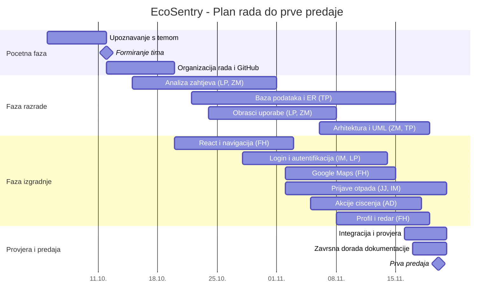

# A. Pregled aktivnosti grupe

**Cilj:** Prikazati kako je tim organizirao projekt, raspodijelio rad, reagirao na važne probleme i pridonio rezultatu. Zapisi trebaju opisivati ishode, a ne samo navoditi da je sastanak održan ili da se o nekoj temi raspravljalo.

## A.1 Evidencija sastanaka

**Cilj:** Voditi kratak zapis projektnih sastanaka i tjedne koordinacije: tko je sudjelovao, što je odlučeno i koja je radnja uslijedila. Raspravu koja nije dovela do odluke zabilježite samo ako je važno pitanje ostalo otvoreno.

**Kratice članova tima:** AD = Antonio Dragun; FH = Fran Hercig; JJ = Jure Jerneić; ZM = Zrina Medić; IM = Ivona Mihaljević; TP = Tin Pavlić; LP = Lorena Pratljačić.

| Datum i sudionici | Glavna tema | Donesena odluka ili zadatak | Poveznica na zadatak ili rezultat, ako postoji |
| --- | --- | --- | --- |
| 15. 10. 2026.; AD, FH, JJ, ZM, IM, TP, LP | Analiza projektne teme i podjela rada | Odrediti glavne funkcionalnosti za građane, eko-udruge i komunalne redare te razraditi zahtjeve i raspodjelu posla. Za koordinaciju podjele zadataka odgovorna ZM. | Inicijalni commit. |
| 20. 10. 2026.; ZM, TP	| Oblikovanje baze podataka i ER modela	| Uskladiti strukturu baze podataka s funkcionalnim zahtjevima aplikacije. TP je zadužen za izradu i doradu ER modela, a ZM za pripremu demonstracijskih podataka i provjeru usklađenosti s dokumentacijom. |	PR #2, PR #12 |
| 26. 10. 2026.; AD, FH, JJ, ZM, IM, TP, LP | Zahtjevi, obrasci uporabe i oblikovanje podataka |  Uskladiti obrasce uporabe s funkcionalnostima aplikacije te razraditi model baze podataka. Za dokumentaciju zahtjeva zadužena LP, za model podataka ZM. | PR #2, PR #10    |
| 29. 10. 2026.; AD, FH, JJ, ZM, IM, TP, LP | Arhitektura i početna implementacija | Definirati povezivanje klijentskog i poslužiteljskog dijela te utvrditi prioritete za autentifikaciju, prijave otpada i prikaz na karti. Nositelji provedbe su FH, IM i LP | PR #1, PR #9, PR #13 |
| 5. 11. 2026.; AD, JJ, LP | Organizacija poslužiteljskog dijela i autentifikacije |	Razdvojiti implementaciju prijava otpada i akcija čišćenja. JJ preuzima obradu prijava otpada, AD razvoj akcija čišćenja, a LP autentifikaciju korisnika. |	PR #13, PR #15, PR #27 |
|12. 11. 2026.; FH, IM, LP	| Usklađivanje korisničkog sučelja s autentifikacijom |	Dogovoriti prikaz navigacije i korisničkog profila nakon prijave te razdvojiti sučelja prema korisničkim ulogama. FH je zadužen za navigaciju i prikaz korisničkog profila, IM za korisničke obrasce, a LP za provjeru povezivanja s autentifikacijom.	| PR #7, PR #14 |
| 16. 11. 2026.; AD, FH, JJ, ZM, IM, TP, LP | Pregled razvoja i priprema prve predaje | Pregledati stanje funkcionalnosti i dokumentacije, uskladiti modele s implementacijom te raspodijeliti preostale zadatke do predaje 20. 11. Za deploy odgovoran FH. Za finalnu dokumentaciju odgovorni ZM i TP. | PR #34 |

## A.2 Plan rada

**Glavni prikaz plana:** Gantogram u nastavku, uz [GitHub repozitorij EcoSentry](https://github.com/zrina163/Progi-1.3) i [GitHub Issues](https://github.com/zrina163/Progi-1.3/issues) za praćenje pojedinačnih zadataka.

Trenutačni plan: Gantogram prikazuje aktivnosti projekta EcoSentry od 5. listopada 2026. do prve predaje 20. studenoga 2026. Plan se temelji na projektnim aktivnostima i podjeli rada među članovima tima. Za ažurnost plana zadužena je ZM.

## Gantogram

## Tablica plana rada

| Razdoblje / Tjedan |	Glavni planirani rad |	Odgovorni članovi |	Poveznica na zadatke |
| --- | --- | --- | --- |
| 5. – 11. 10. |	Upoznavanje s projektnom temom i analiza početnih zahtjeva |	Svi	| — |
| 12. – 18. 10. |	Formiranje tima, podjela odgovornosti i organizacija rada |	Svi	| — |
| 19. – 25. 10. |	Uspostava repozitorija, analiza zahtjeva, početno oblikovanje baze podataka i korisničkog sučelja |	LP, TP, FH, ZM |	PR #1, #2, #3 |
| 26. 10. – 1. 11. |	Izrada obrazaca uporabe, ER modela, navigacije te stranica za prijavu i registraciju |	LP, TP, FH, IM	| PR #6, #7 |
| 2. – 8. 11. |	Razvoj autentifikacije, integracija Google Maps i implementacija poslužiteljskog dijela za prijave otpada |	LP, FH, JJ |	PR #9, #13, #15 |
| 9. – 15. 11. |	Razvoj korisničkog profila, akcija čišćenja, demonstracijskih podataka i dorada arhitekture |	FH, AD, ZM, TP |	PR #12, #14, #27 |
| 16. – 20. 11. |	Izrada sučelja komunalnog redara, usklađivanje UML dijagrama i dokumentacije, provjera funkcionalnosti te priprema prve predaje |	Svi |	PR #31, #35, #36 |

Napomena: Navedena razdoblja predstavljaju okvirni plan aktivnosti, dok povezani GitHub zadaci i pull requestovi omogućuju pregled stvarno izvedenog rada.

## A.3 Aktivnosti i doprinosi članova

**Cilj:** Prikazati koji su članovi radili na važnim projektnim aktivnostima i približan trud koji prijavljuju. Uz implementaciju uključite oblikovanje, dokumentaciju, integraciju, ispitivanje i postavljanje.

| Aktivnost ili rezultat | Član | Prijavljeni sati | Reprezentativni rezultat ili poveznica |
| --- | --- | --- | --- |
| Inicijalizacija React aplikacije, navigacija i Google Maps prikaz | FH | 8 | [PR #1](https://github.com/zrina163/Progi-1.3/pull/1), [PR #6](https://github.com/zrina163/Progi-1.3/pull/6), [PR #9](https://github.com/zrina163/Progi-1.3/pull/9) |
| Oblikovanje stranice prijave, profilnog izbornika i sučelja komunalnog redara | FH | 8 | [PR #14](https://github.com/zrina163/Progi-1.3/pull/14), [PR #31](https://github.com/zrina163/Progi-1.3/pull/31) |
| Implementacija poslužiteljskih funkcija za prijave otpada | JJ | 8 | [PR #15](https://github.com/zrina163/Progi-1.3/pull/15) |
| Implementacija poslužiteljskih funkcija za akcije čišćenja | AD | 12 | [PR #27](https://github.com/zrina163/Progi-1.3/pull/27) |
| Početni ER dijagram baze podataka | ZM | 4 | [PR #2](https://github.com/zrina163/Progi-1.3/pull/2) | 
| Baza podataka i arhitekturne odluke | TP | 12 | [PR #2](https://github.com/zrina163/Progi-1.3/pull/2), [PR #10](https://github.com/zrina163/Progi-1.3/pull/10), [PR #25](https://github.com/zrina163/Progi-1.3/pull/25), [PR #26](https://github.com/zrina163/Progi-1.3/pull/26) |
| Prijava i registracija korisnika te razvoj sučelja za prijavu otpada | IM | 11 | [PR #7](https://github.com/zrina163/Progi-1.3/pull/7); [PR #33](https://github.com/zrina163/Progi-1.3/pull/33)  |
| Analiza zahtjeva i implementacija autentifikacije | LP | 15 | [PR #3](https://github.com/zrina163/Progi-1.3/pull/3), [PR #13](https://github.com/zrina163/Progi-1.3/pull/13) |
| Usklađivanje analize zahtjeva, obrazaca uporabe i UML dijagrama | ZM | 4 | [PR #35](https://github.com/zrina163/Progi-1.3/pull/35) |
| Arhitekturna dokumentacija, dijagram komponenata i dijagram razreda | ZM | 3 | [PR #36](https://github.com/zrina163/Progi-1.3/pull/36) |
| Postavljanje aplikacije na javni poslužitelj | FH | 3 | [PR 41](https://github.com/zrina163/Progi-1.3/pull/41) |

## A.4 Pregled promjena u repozitoriju

**Cilj:** Prikazati kada su promjene napravljene u repozitoriju i tko ih je napravio, uz napomenu da sam broj zapisa promjena ne mjeri kvalitetu doprinosa.

Graf prikazuje doprinose članova tima kroz razvoj projekta. Broj commita nije izravna mjera ukupnog uloženog rada.

## A.5 Ključni inženjerski izazovi i rješenja

| Izazov | Poduzeta radnja | Ishod ili preostalo ograničenje |
| --- | --- | --- |
| Bilo je potrebno omogućiti različite prikaze aplikacije ovisno o ulozi prijavljenog korisnika. | LP je radila na autentifikaciji, a FH na korisničkom profilu, navigaciji i sučelju komunalnog redara. | Razvijeni su odgovarajući dijelovi aplikacije kroz [PR #13](https://github.com/zrina163/Progi-1.3/pull/13), [PR #14](https://github.com/zrina163/Progi-1.3/pull/14) i [PR #31](https://github.com/zrina163/Progi-1.3/pull/31). |
| Prijava otpada razvijala se odvojeno na klijentskom i poslužiteljskom dijelu, zbog čega je trebalo uskladiti njihovo povezivanje. | JJ je implementirao poslužiteljski dio, a IM je radila na korisničkom sučelju za prijavu otpada. | Backend je razvijen kroz [PR #15](https://github.com/zrina163/Progi-1.3/pull/15), a frontend kroz [PR #33](https://github.com/zrina163/Progi-1.3/pull/33). |

